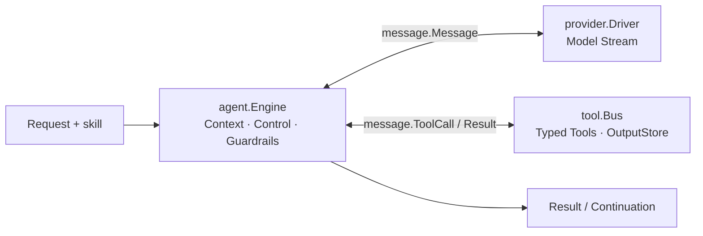

# Venat

[](https://pkg.go.dev/github.com/Viking602/venat/agent)
[](https://github.com/Viking602/venat/actions/workflows/ci.yml)
[](https://github.com/Viking602/venat/releases)

Venat is a typed, direct-import Go SDK for building bounded, long-horizon AI agents. It provides a deterministic model/tool execution loop, streaming provider adapters, schema-validated tools, model-backed working memory, retrievable output artifacts, live steering, and canonical continuation snapshots—while leaving identity, routing policy, multi-agent scheduling, storage schemas, and deployment in application code.

> **Status:** The latest published release is [v0.19.0](https://github.com/Viking602/venat/releases/tag/v0.19.0). Public APIs remain pre-v1.0 and may evolve between minor releases.

## Design principles

- **Direct package composition:** No root façade or hidden global state. Applications import only the packages they use and wire dependencies explicitly.
- **Strict public types:** Exported APIs across all core packages forbid loose `any` fields and `[]any` returns (enforced by AST gates), keeping model messages, tool schemas, and step traces statically typed.
- **Explicit error boundaries:** Terminal agent outcomes (`agent.Result.Failure`: budget exhaustion, guardrail blocks, schema repair exhaustion) are returned as structured data alongside the partial transcript and usage. Transport, context cancellation, and hook/interceptor failures remain explicit Go errors.
- **Ownership safety:** Mutable inputs, streamed events, tool updates, and continuation snapshots are deep-cloned across package boundaries.

## Architecture and packages

Five core packages drive one bounded execution loop from request to result:



| Package | Role in the flow |
| --- | --- |
| [`agent`](https://pkg.go.dev/github.com/Viking602/venat/agent) | Drives the turn loop: prepares context (`WorkingMemory`), streams the model, dispatches tool calls, runs `OutputGuardrail` / `NewToolVerifier` checks, handles live `Control`, and emits `Result` or `Continuation` snapshots |
| [`provider`](https://pkg.go.dev/github.com/Viking602/venat/provider) | Streams normalized model events (`provider/openai`, `provider/anthropic`, `provider/scripted`), enforces connection/idle timeouts, and wraps calls with `StreamInterceptor` |
| [`tool`](https://pkg.go.dev/github.com/Viking602/venat/tool) | Validates and executes sequential or parallel tool batches (`tool/kit`), streams live `UpdateSink` progress, spills large outputs to `OutputStore`, and wraps calls with `Interceptor` |
| [`message`](https://pkg.go.dev/github.com/Viking602/venat/message) | Carries provider-neutral messages, multimodal content parts, tool calls/results, and `ContextView` projections across `agent`, `provider`, and `tool` |
| [`skill`](https://pkg.go.dev/github.com/Viking602/venat/skill) | Discovers and loads `SKILL.md` instructions and resources injected into the initial and compacted agent context |

Executable architecture gates (`make architecture-check`) enforce these import boundaries across production and test code, domain-neutral vocabulary, and public API shape.

## Install

```bash
go get github.com/Viking602/venat@latest
```

Requires **Go 1.25** or newer.

## Quickstart

```go
package main

import (
	"context"
	"fmt"
	"log"
	"time"

	"github.com/Viking602/venat/agent"
	"github.com/Viking602/venat/message"
	"github.com/Viking602/venat/provider/openai"
	"github.com/Viking602/venat/tool"
	"github.com/Viking602/venat/tool/kit"
)

type LookupInput struct {
	Query string `json:"query" jsonschema:"required,description=Search query"`
}

func main() {
	ctx := context.Background()

	modelDriver, err := openai.New(openai.Config{
		APIKey:  "your-api-key",
		WireAPI: openai.WireAPIResponses,
	})
	if err != nil {
		log.Fatal(err)
	}

	lookupTool, err := kit.Tool("lookup", func(ctx context.Context, in LookupInput, updates tool.UpdateSink) (string, error) {
		_ = updates(tool.Update{Kind: tool.UpdateProgress, Message: "searching " + in.Query})
		return "match: venat agent sdk", nil
	}, kit.WithDescription("Search repository records"))
	if err != nil {
		log.Fatal(err)
	}

	engine := agent.Engine{
		Provider: modelDriver,
		Tools:    tool.NewBus(lookupTool),
		Model:    "gpt-4.1-mini",
		ToolMode: tool.ModeSequential,
	}

	result := engine.RunStream(
		ctx,
		agent.Request{
			Prompt: "Find the repository record for venat",
			Budget: &agent.Budget{
				MaxTokens:    16_000,
				MaxToolCalls: 8,
				MaxSteps:     6,
				MaxWallClock: 30 * time.Second,
			},
		},
		agent.OutputPolicy{},
		agent.SinkFunc(func(_ context.Context, frame agent.Frame) error {
			if frame.Kind == agent.FrameTextDelta {
				fmt.Print(frame.Text)
			}
			return nil
		}),
	)
	if result.Failure != nil {
		log.Fatalf("agent stopped: kind=%s reason=%s", result.Failure.Kind, result.Failure.Reason)
	}
	fmt.Printf("\nsteps=%d tokens=%d\n", len(result.Steps), result.Usage.TotalTokens)
	_ = message.RoleAssistant
}
```

## Core capabilities

### 1. Typed tools, process feedback, and parallel batches (`tool`, `tool/kit`)

- **Function tools (`kit.Tool`):** Derives a strict JSON Schema from a Go input struct (rejecting recursive input graphs at construction), validates arguments before execution, and optionally streams `tool.UpdateProgress` or `tool.UpdateOutput` frames via `tool.UpdateSink`.
- **Subprocess and HTTP tools (`kit.ProcessTool`, `kit.HTTPTool`):** `ProcessTool` bounds retained stdout/stderr (first and last 512 KiB up to 1 MiB) while draining excess output, manages process-group timeouts on Darwin/Linux, and converts confirmed nonzero exits into model-visible `IsError` tool results so the model can self-correct. `HTTPTool` confines redirects to the original scheme and host even when a custom `http.Client` is supplied.
- **Ordered concurrency (`tool.ModeParallel`) and streaming overlap (`SafeStreamingTools`):** Contiguous read-only/parallel-safe calls run concurrently in bounded groups while sequential tools act as barriers. Naming trusted read-only tools in `Engine.SafeStreamingTools` lets them start as soon as a complete tool call arrives mid-stream.

### 2. Long-task working memory and output artifacts (`WorkingMemory`, `OutputStore`)

- **Model-backed working memory (`agent.NewWorkingMemory`):** Summarizes older history when approaching `LoopPolicy.ContextTokenTarget` or recovering from `provider.IsContextOverflow`, while preserving system/skill instructions, cache prefixes, recent complete tool exchanges, and fresh user input. Summarized messages are marked `ContextArchived` in `message.ContextView` so the full execution transcript and step trace remain intact. Auxiliary summary token spend is tracked in `Continuation.ContextUsage` and folded into total budget accounting.
- **Retrievable tool output (`tool.NewOutputStore`):** Stores oversized tool results as content-addressed local artifacts, replaces the inline payload with a compact preview and `artifact://<sha256>` reference, and automatically registers `tool_output_read` (paged line/byte reads) and `tool_output_search` (regex search) when attached to `Engine.OutputStore`.

### 3. Live steering, pause continuation, and task verification (`Control`, `NewToolVerifier`)

- **Live execution control (`agent.Control`):**
  - `Control.Send`: Queues additional user context consumed at the next safe turn boundary.
  - `Control.Steer`: Interrupts active model sampling at a safe boundary to redirect the agent; already-started tool calls retain their real results while unstarted pending calls are skipped.
  - `Control.FollowUp`: Defers follow-up instructions until the current task would naturally finish.
  - `Control.Cancel`: Terminates the execution with a caller-supplied cause.
- **Pause continuation and bounded recovery:** Explicit provider pauses (`provider.StopReasonPause` / Anthropic `pause_turn`) automatically continue the task up to a bounded limit before final-answer checks run. Completed turns that fail with malformed tool-call JSON, output-length cutoffs, empty output, or raw plain-text tool-call markup trigger bounded self-correction turns.
- **Executable completion checks (`agent.NewToolVerifier`):** Runs read-only verification tools (such as test suites or linters) inside the `OutputGuardrail` loop before accepting a final answer, feeding failure diagnostics back to the model for repair.
- **Structured output (`agent.OutputPolicy`):** Supports local JSON Schema validation, bounded repair turns (`Validate`, `Repair`, `MaxRepairAttempts`), and opt-in native provider schema forwarding (`Native: true`).

### 4. Synchronous subagents (`NewAgentTool`)

`agent.NewAgentTool` wraps a configured child `agent.Engine` as a non-terminal `tool.Driver`:

```go
researcher, err := agent.NewAgentTool(childEngine, agent.AgentToolConfig{
	Definition: tool.Definition{
		Name:             "researcher",
		Description:      "Delegate a focused research question.",
		ConcurrencyMode:  tool.ConcurrencyParallelSafe,
		ConcurrencyGroup: "subagents",
		MaxConcurrency:   4,
	},
	Budget:   &agent.Budget{MaxTokens: 8_000, MaxSteps: 4},
	MaxDepth: 4,
})
```

Each child keeps an isolated transcript, enforces nesting depth (`MaxDepth`), emits progress-only updates to the parent sink, and shares parent token ceilings through short-held reservations rather than global locks.

### 5. Continuations, resume, and persistence hooks (`Continuation`, Interceptors)

`agent.Continuation` captures the complete provider-neutral execution state at four deterministic phases (`ready`, `model_complete`, `tools_complete`, and `validating_output`) with canonical v1/v2 JSON encoding (`EncodeContinuation` / `DecodeContinuation`) and strict invariant checking (`ValidateContinuation`).

Applications integrate their own database transactions, distributed leases, or audit logs without adopting a framework-owned state machine by combining:

- `agent.BoundaryObserver` (`Engine.Boundaries`) to persist `Continuation` snapshots at safe boundaries and resume with `Engine.Resume` / `Engine.ResumeStream`;
- `provider.StreamInterceptor` (`Engine.ModelInterceptor`) and `tool.Interceptor` (`Engine.ToolInterceptor`), keyed by deterministic `OperationID` values (`turn:<N>:model`, `turn:<N>:call:<M>`).

## Executable examples

All examples under [`examples/`](examples) are self-contained and run with deterministic local providers (no API keys required):

| Example | Demonstrated path | Command |
| --- | --- | --- |
| `agent` | Single-agent loop with tool progress/output updates | `go run ./examples/agent` |
| `subagent` | Parent agent delegating to a child `Engine` via `NewAgentTool` | `go run ./examples/subagent` |
| `interactive` | Failed subprocess → live `Control` input → repaired command → native JSON Schema output + boundary validation | `go run ./examples/interactive` |
| `tool-output` | Oversized tool output spilled to `OutputStore` and recovered via `tool_output_read` | `go run ./examples/tool-output` |
| `working-memory` | Model-backed `WorkingMemory` summarization and `ContextUsage` accounting | `go run ./examples/working-memory` |
| `parallel-tools` | Barriered parallel tool groups (`ModeParallel`) | `go run ./examples/parallel-tools` |
| `task-verification` | Premature completion rejected by `NewToolVerifier` until real check passes | `go run ./examples/task-verification` |
| `streaming-tools` | Early read-only tool execution with `SafeStreamingTools` | `go run ./examples/streaming-tools` |
| `pause-continuation` | Automatic continuation across `StopReasonPause` turns | `go run ./examples/pause-continuation` |
| `live-steering` | Mid-run direction change via `Control.Steer` | `go run ./examples/live-steering` |

## Documentation

- [Documentation index](docs/index.md)
- [Quickstart](docs/quickstart.md)
- [Public API reference](docs/public-api.md)
- [Agent execution guide](docs/agent-execution.md)
- [Extensions: hooks, interceptors, observers, and sinks](docs/extensions.md)
- [Provider, tool, and skill development](docs/plugin-development.md)
- [Architecture boundaries](docs/architecture-boundaries.md)
- [Security hardening and resource bounds](docs/security-hardening.md)
- [Migration guide](docs/migration.md)
- [ADR-031: Core 5-package SDK consolidation](docs/adr/ADR-031-core-agent-sdk-consolidation.md)
- [ADR-030: Stream lifecycle semantics](docs/adr/ADR-030-stream-lifecycle-semantics.md)

## Development and verification

```bash
make verify     # Fast local gate: fmt-check, vet, tidy-check, golangci-lint, unit tests, and architecture checks
make ci-local   # Full CI-parity gate: adds staticcheck, govulncheck, and race-detector tests
```

See [CONTRIBUTING.md](CONTRIBUTING.md) for coding conventions, public API rules, and commit guidelines.

## License

[MIT](LICENSE)
